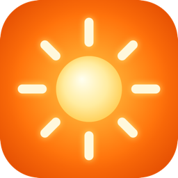
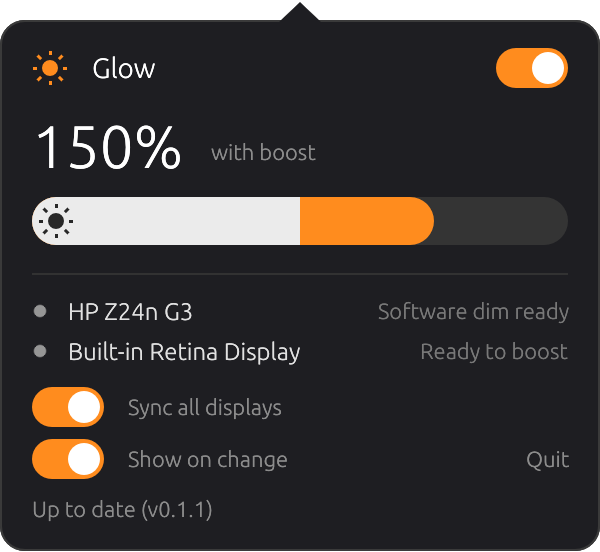

# Glow



Make your Mac screen brighter than it normally goes, and dim all your screens together. Glow lives in the menu bar.

## What it does

- **Brighter than 100%.** On Macs with an XDR or HDR screen, slide past 100% for extra brightness. Glow opens at 120%.
- **Dim everything together.** Turn down your laptop and external monitors with one slider.
- **Your brightness keys still work.** Pressing brightness-up at full brightness goes brighter. Handy in a bright room. Turn the switch at the top of the panel off to stop it.

## What it looks like

Click the sun in the menu bar. A small panel opens under it.

<table>
<tr>
<td width="320" valign="top"></td>
<td valign="top">

- A big percentage, such as **150%**.
- One slider from 0% to 200%.
- A list of your screens, each with its current state.
- Two switches: **Sync all displays** and **Show on change**.
- A **Quit** button. Quitting puts every screen back to normal.

Right-click the sun for a short menu.

</td>
</tr>
</table>

## Requirements

- macOS 13 or later.
- An XDR or HDR screen for the extra brightness. Dimming works on any display.

## Install

Glow is not notarized by Apple, so a downloaded copy shows an "unverified developer" warning.
To avoid the warning, build it yourself (Option 1). An app you build on your own Mac opens with a
normal double-click.

### Option 1: Build it yourself (no warning)

1. Open **Terminal** and install Apple's command-line tools. Skip this if you have them.

   ```sh
   xcode-select --install
   ```

2. Install [Rust](https://rustup.rs):

   ```sh
   curl --proto '=https' --tlsv1.2 -sSf https://sh.rustup.rs | sh
   ```

   Then close and reopen Terminal.

3. Download Glow and build it:

   ```sh
   git clone https://github.com/JieGH/glow.git
   cd glow
   scripts/build-app.sh
   ```

   The first build takes a few minutes.

4. Move the app to Applications and open it:

   ```sh
   cp -R dist/Glow.app /Applications/
   open /Applications/Glow.app
   ```

To update later, run `git pull`, then steps 3 and 4 again.

### Option 2: Download it (shows a warning)

1. Download `Glow.dmg` (or `Glow.zip`) from [Releases](https://github.com/JieGH/glow/releases).
2. Open the dmg and drag **Glow** to **Applications**. For the zip, unzip it and move `Glow.app` there.
3. Open Glow. macOS blocks it the first time. Go to **System Settings → Privacy & Security**,
   scroll down and click **Open Anyway**.

## Use

- **Click** the sun to open the panel.
- **Right-click** the sun for the menu.

## A note on private APIs

Glow reads and sets the system brightness through `DisplayServices`, a private macOS framework.
Apple may change it in any macOS update, and it rules Glow out of the Mac App Store. If a macOS
update breaks brightness control, please open an issue.

## License

[MIT](LICENSE)
